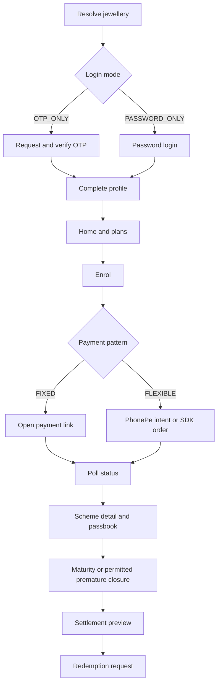
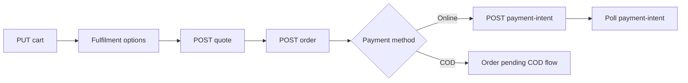

# SwarnaGrow Customer API Guide for Flutter

**Backend source of truth:** `https://github.com/AadithGino/swarna-grow-backend.git` (branch `ecommerce`)  
**Verified commit:** `b1a03cd`  
**API prefix:** `/api/v1`  
**Audience:** Flutter customer application developers  

Canonical copy (same content): `docs/FLUTTER_CUSTOMER_API_GUIDE.md`.

This guide was derived from the current route registrations, Zod validators, DTO mappers, services, enums, and error middleware in the backend source. It does not use the deprecated v1.2 contract bundle.

### What changed since commit `8e014b7` (Flutter integration impact)

| Area | Summary |
|------|---------|
| **Ecommerce shop** | Full customer shop under `/app/shop/*` — availability, catalog, cart, quotes, orders, PhonePe/COD checkout, cancellations, returns. |
| **Banners** | Scheduled promo rails on home and shop: `GET /app/home/banners`, `GET /app/shop/banners` with typed destinations (no arbitrary URLs). |
| **FCM / inbox** | Ecommerce order lifecycle pushes, product/category/offer promotions, **scheme** and **shop** gold-rate announcements; richer `data` payload (rate metadata, `productId`, `deepLink`). |
| **Gold rates** | Scheme `/app/gold-rate/*` unchanged for 22K scheme math; shop uses separate ecommerce purity rates inside product pricing (server-computed). |
| **Deep links** | Route map must handle `/shop`, `/shop/order/{id}`, `/shop/products/{slug}`, `/gold-rate/current`, plus existing `/payments`, `/schemes`. |

**Related backend docs:** [`docs/FLUTTER_CUSTOMER_ECOMMERCE_AND_DIGITAL_METALS_INTEGRATION.md`](docs/FLUTTER_CUSTOMER_ECOMMERCE_AND_DIGITAL_METALS_INTEGRATION.md) (**ecommerce + Digital Gold end-to-end flows**), [`docs/ECOMMERCE_CUSTOMER_APP_GUIDE.md`](docs/ECOMMERCE_CUSTOMER_APP_GUIDE.md) (**shop payloads**), `docs/DIGITAL_METALS_API_CONTRACT.md`, `docs/ECOMMERCE_API_CONTRACT.md`, `docs/FCM_CUSTOMER_APP_INTEGRATION.md`, `docs/ECOMMERCE_PROMOTION_FCM.md`, `docs/DEPLOY_VERCEL_AND_WORKERS.md`.

## 1. Transport conventions

### Required headers

```http
Content-Type: application/json
Authorization: Bearer <accessToken>       # authenticated routes
X-Idempotency-Key: <8-to-128-char-key>    # state-changing routes marked idempotent
X-Platform: android                        # recommended: android | ios
X-App-Version: 1.0.0                       # recommended
```

Generate a new idempotency key for each logical user action and retain it while retrying that same action. Never generate a new key merely because the HTTP request timed out.

### Success envelopes

Single object:

```json
{
  "success": true,
  "data": {}
}
```

Paginated list:

```json
{
  "success": true,
  "data": [],
  "meta": {
    "total": 0,
    "limit": 50,
    "nextCursor": null
  }
}
```

### Error envelope

```json
{
  "success": false,
  "error": {
    "code": "VALIDATION_FAILED",
    "message": "Please correct the highlighted fields.",
    "details": [
      { "field": "body.amountPaise", "message": "Expected number" }
    ],
    "traceId": "trace_..."
  }
}
```

The app must branch on `error.code`, not English message text. Preserve `traceId` in support logs.

### Money, gold and dates

- All request amounts are integer **paise**: ₹1,000 = `100000`.
- All gold weights are integer **milligrams**: 1 gram = `1000` mg.
- Money DTOs normally contain `amountPaise`, `amountRupees`, and `amountDisplay`.
- Weight DTOs normally contain `weightMg`, `weightGrams`, and `weightDisplay`.
- Calendar dates use `YYYY-MM-DD`; cycles use `YYYY-MM`; timestamps use ISO-8601.
- Gold calculations use the jeweller's published **22K** rate. Do not calculate final credited weight in Flutter; display the backend value.

## 2. Supported scheme combinations

| Value basis | Payment pattern | Meaning | Customer payment endpoint |
|---|---|---|---|
| `CASH` | `FIXED` | Fixed rupee installments | `POST /app/schemes/{id}/pay` |
| `GOLD_WEIGHT` | `FIXED` | Fixed money installments converted to 22K weight | `POST /app/schemes/{id}/pay` |
| `CASH` | `FLEXIBLE` | Optional free-window contributions, then capped cycles | `POST /app/schemes/{id}/payment-intents` or `/pay/sdk-order` |
| `GOLD_WEIGHT` | `FLEXIBLE` | Same flexible rules; successful money converts to 22K weight | `POST /app/schemes/{id}/payment-intents` or `/pay/sdk-order` |

Fixed amount modes:

| `amountMode` | Flutter behavior |
|---|---|
| `JEWELLER_FIXED` | Use backend fixed amount; do not show custom amount input. |
| `JEWELLER_SLABS` | Show only values returned in `enrol.slabs` / `amountRules.slabsPaise`. |
| `CUSTOMER_CHOSEN` | Require an amount within min/max and in the stated multiple. Persisted at enrolment. |

Benefit types are `FIXED_BONUS_AMOUNT`, `ONE_FREE_INSTALLMENT`, and `TEXT_ONLY`. Redemption benefit treatment is `FORFEIT` or `FULL`; there is no `PRORATE`.

Redemption modes are `CASH`, `GOLD_HANDOVER`, and `PURCHASE_ADJUSTMENT`. There is no transfer-to-scheme mode.

## 3. Recommended Flutter flow



On every launch:

1. Read stored tokens securely.
2. If access token is near expiry, call refresh.
3. Fetch `/app/auth/me` or `/app/profile`.
4. Fetch `/app/home`.
5. `GET /app/shop/availability` — decide whether to show shop entry (even when home is visible).
6. Register/update the FCM token (`POST /app/devices/fcm-token`).
7. If `meta.nextVisibilityChangeAt` was returned from banner APIs, schedule a refresh at that time.

## 4. Jewellery discovery and authentication

### Resolve jewellery

```http
GET /api/v1/public/tenants/resolve?tenantCode=KAIRALI
```

Alternative query inputs supported by the service are `mobile` or `deepLinkToken`.

Example:

```json
{
  "success": true,
  "data": {
    "resolvedBy": "CODE",
    "tenantCode": "KAIRALI",
    "tenants": [
      {
        "id": "tenant_01",
        "tenantCode": "KAIRALI",
        "displayName": "Kairali Jewellers",
        "appDisplayName": "Kairali Gold Savings",
        "logoUrl": "/uploads/upload_logo_01",
        "primaryColor": "#730321",
        "accentColor": "#C9A227",
        "customerSelfEnrol": true,
        "customerSelfRegistration": true,
        "kycMandatory": false,
        "multiScheme": true,
        "customerLoginMode": "OTP_ONLY",
        "customerAppWriteEnabled": true,
        "customerAppPaymentsEnabled": true,
        "status": "ACTIVE"
      }
    ]
  }
}
```

If multiple tenants are returned for mobile discovery, show a jewellery picker.

### Request OTP

```http
POST /api/v1/public/auth/otp/request
X-Idempotency-Key: otp-request-550e8400

{
  "tenantCode": "KAIRALI",
  "mobile": "+919876543210",
  "purpose": "LOGIN",
  "deviceId": "flutter-device-uuid"
}
```

`purpose` is `LOGIN` or `SIGNUP` for the customer app.

```json
{
  "success": true,
  "data": {
    "otpId": "550e8400-e29b-41d4-a716-446655440000",
    "channel": "SMS",
    "maskedMobile": "******3210",
    "resendAvailableInSeconds": 30,
    "attemptsAllowed": 5,
    "expiresInSeconds": 300,
    "isRegistered": true
  }
}
```

Important errors: `CUSTOMER_NOT_REGISTERED`, `SELF_REGISTRATION_DISABLED`, and `CUSTOMER_AUTH_MODE_PASSWORD_ONLY`.

### Verify OTP / create customer session

```http
POST /api/v1/public/auth/otp/verify
X-Idempotency-Key: otp-verify-550e8400

{
  "tenantCode": "KAIRALI",
  "mobile": "+919876543210",
  "purpose": "LOGIN",
  "deviceId": "flutter-device-uuid",
  "otpId": "550e8400-e29b-41d4-a716-446655440000",
  "otp": "123456",
  "deviceInfo": {
    "deviceId": "flutter-device-uuid",
    "platform": "android",
    "appVersion": "1.0.0",
    "osVersion": "15",
    "deviceModel": "Pixel 9"
  }
}
```

```json
{
  "success": true,
  "data": {
    "isNewCustomer": false,
    "profileComplete": true,
    "customer": {
      "id": "customer_01",
      "name": "Anu Joseph",
      "mobile": "+919876543210",
      "branchId": "branch_01",
      "passbookNumber": "PB-00124",
      "branch": { "id": "branch_01", "name": "Main Branch", "code": "HO" },
      "profileComplete": true
    },
    "tenantCapabilities": {
      "customerSelfEnrol": true,
      "customerSelfRegistration": true,
      "kycMandatory": false,
      "multiScheme": true,
      "customerLoginMode": "OTP_ONLY",
      "customerAppWriteEnabled": true,
      "customerAppPaymentsEnabled": true
    },
    "accessToken": "eyJ...",
    "refreshToken": "...",
    "expiresIn": 2592000,
    "tokenType": "Bearer"
  }
}
```

For signup, send `purpose: "SIGNUP"`. The backend creates a minimal customer only after valid OTP verification.

### Password login

Only use this when `customerLoginMode == "PASSWORD_ONLY"`.

```http
POST /api/v1/public/auth/login-password

{
  "tenantCode": "KAIRALI",
  "mobile": "+919876543210",
  "password": "4821",
  "deviceId": "flutter-device-uuid"
}
```

The response uses the same customer/session shape as OTP verify. Handle `CUSTOMER_PASSWORD_NOT_SET` and `CUSTOMER_AUTH_MODE_OTP_ONLY`.

### Refresh, current user and logout

```http
POST /api/v1/app/auth/refresh
{ "refreshToken": "..." }
```

```http
GET /api/v1/app/auth/me
Authorization: Bearer <accessToken>
```

```http
POST /api/v1/app/auth/logout
Authorization: Bearer <accessToken>
{ "refreshToken": "..." }
```

After refresh, atomically replace both stored tokens. On `401`, attempt refresh once; never loop indefinitely.

## 5. Profile, KYC, nominee and uploads

### Profile

```http
GET /api/v1/app/profile
```

```json
{
  "success": true,
  "data": {
    "id": "customer_01",
    "customerNumber": "C0124",
    "passbookNumber": "PB-00124",
    "name": "Anu Joseph",
    "mobile": "+919876543210",
    "mobileImmutable": true,
    "email": "anu@example.com",
    "address": { "line1": "Rose Villa", "city": "Kochi", "pincode": "682001" },
    "branch": { "id": "branch_01", "code": "HO", "name": "Main Branch" },
    "profileComplete": true,
    "profileCompleteness": { "filled": 3, "total": 3, "complete": true },
    "kyc": {
      "status": "NOT_SUBMITTED",
      "statusLabel": "Not submitted",
      "type": null,
      "canUpdate": true,
      "verifiedAt": null
    },
    "nominee": null,
    "version": 3
  }
}
```

`kyc` can be absent when the jeweller has not enabled customer KYC for enrolment. Treat absence as “not requested”, not as a parsing failure.

Complete required profile:

```http
POST /api/v1/app/profile/complete
X-Idempotency-Key: profile-complete-01

{
  "name": "Anu Joseph",
  "email": "anu@example.com",
  "address": {
    "line1": "Rose Villa",
    "city": "Kochi",
    "pincode": "682001"
  }
}
```

Patch uses `PATCH /api/v1/app/profile` with any of the same fields. Mobile and branch cannot be changed by the customer.

### Upload KYC/support attachments

1. Presign:

```http
POST /api/v1/app/uploads/presign
X-Idempotency-Key: upload-kyc-front-01

{
  "purpose": "KYC_DOCUMENT",
  "fileName": "aadhaar-front.jpg",
  "contentType": "image/jpeg",
  "sizeBytes": 245812
}
```

2. Upload bytes to the returned storage URL using its returned method/headers.
3. Complete: `POST /api/v1/app/uploads/{uploadId}/complete` with an idempotency key.
4. Submit KYC:

```http
PUT /api/v1/app/profile/kyc
X-Idempotency-Key: kyc-submit-01

{
  "type": "AADHAAR",
  "number": "123412341234",
  "frontUploadId": "upload_front_01",
  "backUploadId": "upload_back_01"
}
```

Allowed types are `AADHAAR` and `PAN`, further restricted by the jeweller's configuration. Handle `KYC_NOT_ENABLED`.

### Nominee

```http
PUT /api/v1/app/profile/nominee
X-Idempotency-Key: nominee-save-01

{
  "name": "Joseph Mathew",
  "relationship": "PARENT",
  "mobile": "+919876540000",
  "address": "Rose Villa, Kochi",
  "expectedVersion": 3
}
```

Relationships: `SPOUSE`, `PARENT`, `CHILD`, `SIBLING`, `RELATIVE`, `FRIEND`, `OTHER`.

Delete with `DELETE /api/v1/app/profile/nominee` and body `{ "expectedVersion": 4 }` plus an idempotency key.

## 6. Home, plans and enrolment

### Home

```http
GET /api/v1/app/home?includeTrends=true&trendMonths=6
```

Key response sections are `tenant`, `customer`, `greeting`, `summary`, optional `goldRate`, `actionCard`, `activeSchemes`, `recentPayments`, `quickActions`, `unreadNotificationCount`, and optional contribution/gold trends.

Promotional **home banners** are **not** embedded in `/app/home`. Fetch them separately:

```http
GET /api/v1/app/home/banners
Authorization: Bearer <accessToken>
```

Returns `{ items, meta }` when the tenant plan includes ecommerce; otherwise `{ items: [], meta }`. Use `meta.nextVisibilityChangeAt` to refresh when a scheduled promo starts or ends (see §12A).

Partial refunds are netted. A recent payment can include:

```json
{
  "id": "payment_01",
  "amount": { "amountPaise": 75000, "amountRupees": 750, "amountDisplay": "₹750" },
  "grossAmount": { "amountPaise": 100000, "amountRupees": 1000, "amountDisplay": "₹1,000" },
  "refundedAmount": { "amountPaise": 25000, "amountRupees": 250, "amountDisplay": "₹250" },
  "netAmount": { "amountPaise": 75000, "amountRupees": 750, "amountDisplay": "₹750" },
  "status": "PARTIALLY_REFUNDED"
}
```

### List plans

```http
GET /api/v1/app/scheme-plans?limit=50
```

Example fixed customer-chosen cash plan:

```json
{
  "id": "plan_fixed_cash",
  "code": "CASH11",
  "displayName": "Monthly Gold Purchase Plan",
  "valueBasis": "CASH",
  "paymentPattern": "FIXED",
  "durationMonths": 12,
  "amountRules": {
    "amountMode": "CUSTOMER_CHOSEN",
    "fixedAmountPaise": null,
    "slabsPaise": [],
    "minInstallmentPaise": 100000,
    "maxInstallmentPaise": 1000000,
    "multipleOfPaise": 50000
  },
  "enrol": {
    "amountMode": "CUSTOMER_CHOSEN",
    "minInstallment": { "amountPaise": 100000, "amountDisplay": "₹1,000" },
    "maxInstallment": { "amountPaise": 1000000, "amountDisplay": "₹10,000" },
    "multipleOf": { "amountPaise": 50000, "amountDisplay": "₹500" },
    "firstInstallmentModeDefault": "COLLECT_NOW",
    "firstInstallmentRequired": true
  },
  "benefitType": "ONE_FREE_INSTALLMENT",
  "canEnrol": true,
  "blockedReason": null
}
```

Example flexible gold-weight plan fields:

```json
{
  "id": "plan_flex_gold",
  "valueBasis": "GOLD_WEIGHT",
  "paymentPattern": "FLEXIBLE",
  "durationMonths": 12,
  "flexibleSummary": {
    "freeWindowMonths": 6,
    "lockWindowMonths": 5,
    "minPerPayment": { "amountPaise": 10000, "amountDisplay": "₹100" },
    "maxPerPayment": { "amountPaise": 500000, "amountDisplay": "₹5,000" }
  },
  "canEnrol": true
}
```

Always use `canEnrol` and show `blockedReason`; do not reproduce policy checks in Flutter.

### Enrolment request matrix

Endpoint:

```http
POST /api/v1/app/schemes/enrol
X-Idempotency-Key: enrol-plan_fixed_cash-01
```

| Plan | Required body |
|---|---|
| Fixed jeweller-fixed | `{ "planId": "...", "payNow": true, "redirectUrl": "https://app.example/payment-return" }` |
| Fixed slabs | Add `installmentAmountPaise` equal to one returned slab. |
| Fixed customer-chosen | Add `installmentAmountPaise` satisfying min/max/multiple. |
| Flexible | Add initial `installmentAmountPaise`; backend validates the plan's free-window range/increment. |
| Start next cycle | Send `payNow: false`; no checkout object is returned and scheme starts `ACTIVE`. |

Fixed `COLLECT_NOW` response:

```json
{
  "success": true,
  "data": {
    "scheme": { "id": "scheme_01", "schemeNumber": "ENR-0000124" },
    "paymentType": "FIXED_PAYMENT_LINK",
    "paymentLink": {
      "id": "link_01",
      "paymentLinkId": "link_01",
      "token": "public-link-token",
      "gatewayUrl": "/pay/public-link-token",
      "amount": { "amountPaise": 100000, "amountDisplay": "₹1,000" },
      "status": "CREATED",
      "expiresAt": "2026-09-25T13:00:00.000Z"
    }
  }
}
```

Flexible `COLLECT_NOW` response:

```json
{
  "success": true,
  "data": {
    "scheme": { "id": "scheme_02", "schemeNumber": "ENR-0000125" },
    "paymentType": "FLEXIBLE_PAYMENT_INTENT",
    "paymentIntent": {
      "id": "intent_01",
      "intentId": "intent_01",
      "schemeId": "scheme_02",
      "targetCycle": "2026-09",
      "amount": { "amountPaise": 150000, "amountDisplay": "₹1,500" },
      "status": "PENDING",
      "positionVersion": 0,
      "paymentUrl": "https://phonepe.example/...",
      "statusPollUrl": "/app/payment-intents/intent_01",
      "retryAfterSeconds": 3
    }
  }
}
```

If PhonePe initiation returns `5xx`, retry the same enrol request with the same idempotency key/body. The backend resumes the pending enrolment and does not create a duplicate scheme.

## 7. Scheme details and payable range

### Lists

```http
GET /api/v1/app/schemes?limit=50
GET /api/v1/app/schemes?group=PAST&limit=50
GET /api/v1/app/schemes/{schemeId}
GET /api/v1/app/schemes/{schemeId}/passbook
```

Scheme statuses: `PENDING_PAYMENT`, `ENROLMENT_EXPIRED`, `ACTIVE`, `LOCKED`, `DEFAULTED`, `MATURED`, `REDEEMED`, `CLOSED_PREMATURE`.

Display modes: `FIXED`, `FLEXIBLE_FREE_WINDOW`, `FLEXIBLE_LOCK_WINDOW`.

The detail DTO supplies UI-authoritative fields such as `payButton`, `redemption`, `planRules`, `payableRange`, `payments`, `version`, and `positionVersion`. Use these instead of reconstructing lifecycle logic.

### Payable range

```http
GET /api/v1/app/schemes/{schemeId}/payable-range
GET /api/v1/app/schemes/{schemeId}/payable-range?targetCycle=2026-10
```

Fixed example:

```json
{
  "success": true,
  "data": {
    "model": "FIXED",
    "phase": null,
    "payable": true,
    "minPayable": { "amountPaise": 100000, "amountDisplay": "₹1,000" },
    "maxPayable": { "amountPaise": 300000, "amountDisplay": "₹3,000" },
    "suggested": { "amountPaise": 100000, "amountDisplay": "₹1,000" },
    "partialPaymentAllowed": false,
    "advancePaymentAllowed": true,
    "maxAdvanceInstallments": 2,
    "allowedAmountsPaise": [100000, 200000, 300000],
    "expectedPositionVersion": 7,
    "reservationExpiresAt": null
  }
}
```

Flexible free-window example:

```json
{
  "success": true,
  "data": {
    "model": "FLEXIBLE",
    "phase": "FLEXIBLE",
    "targetCycle": "2026-09",
    "contributionIsOptional": true,
    "payable": true,
    "minPayable": { "amountPaise": 10000, "amountDisplay": "₹100" },
    "maxPayable": { "amountPaise": 500000, "amountDisplay": "₹5,000" },
    "multipleOfPaise": 10000,
    "helperText": "Contributions are optional in this phase. Unused monthly allowance does not carry forward. Paid amounts remain in your scheme permanently.",
    "paidMoneyNeverExpires": true,
    "unusedAllowanceCarriesForward": false,
    "expectedPositionVersion": 2
  }
}
```

Flexible capped-cycle example:

```json
{
  "success": true,
  "data": {
    "model": "FLEXIBLE",
    "phase": "CAPPED",
    "targetCycle": "2026-10",
    "payable": true,
    "cycleCap": { "amountPaise": 200000, "amountDisplay": "₹2,000" },
    "paidThisCycle": { "amountPaise": 75000, "amountDisplay": "₹750" },
    "remainingThisCycle": { "amountPaise": 125000, "amountDisplay": "₹1,250" },
    "minPayable": { "amountPaise": 10000, "amountDisplay": "₹100" },
    "maxPayable": { "amountPaise": 125000, "amountDisplay": "₹1,250" },
    "finalRemainderException": true,
    "allowFutureCycleSelection": true,
    "targetCycleOptions": [
      {
        "cycle": "2026-10",
        "label": "Oct 2026",
        "remaining": { "amountPaise": 125000, "amountDisplay": "₹1,250" },
        "isCurrentCycle": true
      }
    ],
    "expectedPositionVersion": 9
  }
}
```

Rules:

- Free phase: any valid amount/increment, any number of permitted transactions, within server quote.
- Capped phase: cap is a maximum, not a mandatory installment. A qualifying contribution may be below cap.
- Future cycle payment is possible only when returned by `targetCycleOptions`.
- Cycles are calendar months. The final maturity-only calendar cycle is not payable.
- Re-fetch payable range immediately before payment. Send its `expectedPositionVersion`.

## 8. PhonePe payment flows

### Fixed scheme

```http
POST /api/v1/app/schemes/{schemeId}/pay
X-Idempotency-Key: fixed-pay-01

{
  "amountPaise": 100000,
  "redirectUrl": "https://app.example/payment-return",
  "mobile": "+919876543210"
}
```

Open the returned `gatewayUrl` in a secure web view/external browser. Poll:

```http
GET /api/v1/app/payments/{paymentLinkId}/status
```

### Flexible redirect intent

```http
POST /api/v1/app/schemes/{schemeId}/payment-intents
X-Idempotency-Key: flexible-intent-01

{
  "amountPaise": 75000,
  "targetCycle": "2026-10",
  "expectedPositionVersion": 9,
  "redirectUrl": "https://app.example/payment-return",
  "mobile": "+919876543210"
}
```

### Flexible native SDK order

```http
POST /api/v1/app/schemes/{schemeId}/pay/sdk-order
X-Idempotency-Key: flexible-sdk-01

{
  "amountPaise": 75000,
  "targetCycle": "2026-10",
  "expectedPositionVersion": 9,
  "mobile": "+919876543210"
}
```

Use the provider token/order identifiers returned by the backend. Never accept scheme/customer/amount authority from a callback or local app state.

### Poll intent

```http
GET /api/v1/app/payment-intents/{intentId}
```

```json
{
  "success": true,
  "data": {
    "intentId": "intent_01",
    "schemeId": "scheme_02",
    "status": "PAID",
    "processing": false,
    "paid": true,
    "failed": false,
    "receipt": {
      "paymentId": "payment_01",
      "receiptNumber": "RCP-2026-00124",
      "paidAt": "2026-09-25T07:20:00.000Z"
    },
    "updatedScheme": { "id": "scheme_02", "status": "ACTIVE" },
    "retryAfterSeconds": null
  }
}
```

UI poll states: `PROCESSING`, `PAID`, `FAILED`, `EXPIRED`, `CANCELLED`. Poll at `retryAfterSeconds`, stop at a terminal state, and cap the client polling window. The backend reconciliation worker remains authoritative after the UI stops.

Cancel a pending intent:

```http
POST /api/v1/app/payment-intents/{intentId}/cancel
X-Idempotency-Key: cancel-intent-01

{ "expectedPositionVersion": 9 }
```

Concurrency/review outcomes such as `UNALLOCATED_PENDING_REVIEW` or `AMOUNT_MISMATCH_PENDING_REVIEW` must be shown as “Payment received—verification pending”; do not tell the user to pay again.

Gold-weight payment blockers:

- `GOLD_RATE_NOT_SET`: today's 22K rate is missing; disable payment and retry after the jeweller publishes it.
- `GOLD_WEIGHT_ROUNDS_TO_ZERO`: amount is too small under the plan rounding/precision rule.

## 9. Payments, receipt and passbook

```http
GET /api/v1/app/payments?limit=50&cursor=<cursor>
GET /api/v1/app/payments/{paymentId}
GET /api/v1/app/payments/{paymentId}/receipt
GET /api/v1/app/schemes/{schemeId}/passbook
```

Payment statuses: `PENDING`, `SUCCESS`, `FAILED`, `AMOUNT_MISMATCH_PENDING_REVIEW`, `UNALLOCATED_PENDING_REVIEW`, `PARTIALLY_REFUNDED`, `REVERSED`.

Payment list item:

```json
{
  "id": "payment_01",
  "amount": { "amountPaise": 75000, "amountDisplay": "₹750" },
  "grossAmount": { "amountPaise": 100000, "amountDisplay": "₹1,000" },
  "refundedAmount": { "amountPaise": 25000, "amountDisplay": "₹250" },
  "netAmount": { "amountPaise": 75000, "amountDisplay": "₹750" },
  "grossAmountPaise": 100000,
  "refundedAmountPaise": 25000,
  "netAmountPaise": 75000,
  "status": "PARTIALLY_REFUNDED",
  "statusLabel": "Partially refunded",
  "schemeId": "scheme_01",
  "schemeNumber": "ENR-0000124",
  "schemeName": "Gold Savings 11+1",
  "receiptNumber": null,
  "channel": "PHONEPE",
  "targetCycle": "2026-09",
  "valueBasis": "GOLD_WEIGHT",
  "goldAccrual": {
    "grossWeightMg": 200,
    "refundedWeightMg": 50,
    "netWeightMg": 150
  }
}
```

The receipt endpoint returns a PDF/binary response. Only enable it when `receiptDownloadPath` exists.

## 10. Maturity, premature closure and redemption

### Settlement preview

```http
GET /api/v1/app/schemes/{schemeId}/settlement-preview?type=MATURITY_REDEMPTION&mode=CASH
```

For premature closure use `type=PREMATURE_CLOSURE`. For gold-weight plans, `mode` is required because cash valuation and physical handover differ.

Typical fields include principal, benefit, penalty, settlement, rate/weight lines, eligibility/blockers, allowed modes, `systemPolicyClosure`, and mode-specific previews. Treat them as display data; do not recalculate.

Mode behavior:

| Plan basis | Mode | Backend settlement behavior |
|---|---|---|
| Cash | `CASH` | Net principal + eligible benefit − penalty. |
| Cash | `GOLD_HANDOVER` | Cash settlement converted with exact handover-day 22K rate. |
| Cash | `PURCHASE_ADJUSTMENT` | Settlement applied to jewellery bill; cash out is zero; bill number required. |
| Gold weight | `CASH` | Eligible net mg valued at exact completion-day 22K rate, less penalty. |
| Gold weight | `GOLD_HANDOVER` | Physical mg after benefit/penalty weight and plan precision. |
| Gold weight | `PURCHASE_ADJUSTMENT` | Value applied to bill; cash out and handover weight are zero. |

System-policy flexible closure (`ZERO_FLEXIBLE_PHASE_TOTAL` or `BELOW_MINIMUM_FLEXIBLE_PHASE_TOTAL`) is principal-only: no benefit and no penalty. The backend classifies it; the client must not send a spoofed flag.

### Request redemption

```http
POST /api/v1/app/schemes/{schemeId}/redemption-request
X-Idempotency-Key: redemption-scheme_01-cash

{
  "preferredMode": "CASH",
  "preferredDate": "2026-10-02",
  "remarks": "Please process at main branch",
  "expectedVersion": 12
}
```

Purchase adjustment:

```json
{
  "preferredMode": "PURCHASE_ADJUSTMENT",
  "remarks": "Apply to purchase invoice",
  "expectedVersion": 12,
  "modeDetails": { "billNumber": "INV-2026-445" }
}
```

Important blockers:

- `MATURITY_CONTRIBUTIONS_INCOMPLETE`: fixed plan has unpaid required installments.
- `REDEMPTION_MODE_REQUIRED`: mode missing where required.
- `REDEMPTION_MODE_NOT_ALLOWED`: mode not enabled on the plan.
- `KYC_REQUIRED`: jeweller enabled redemption KYC and customer is not verified.
- `GOLD_RATE_NOT_SET`: exact-date 22K rate required for valuation/handover.
- `SETTLEMENT_NON_POSITIVE` / `GOLD_WEIGHT_ROUNDS_TO_ZERO`.
- Existing redemption request already in progress.

Customer flow ends at request. Staff/admin approval and completion occur outside the customer app. Refresh scheme detail until the pending/completed redemption status changes.

## 11. Notifications and FCM

### In-app inbox

```http
GET /api/v1/app/notifications?limit=50&cursor=<cursor>
POST /api/v1/app/notifications/{notificationId}/read
POST /api/v1/app/notifications/read-all
```

Both POST routes require `X-Idempotency-Key`. Rows are **deduplicated by business event** (WhatsApp + push copies collapse to one inbox item). Marking one read can mark sibling channel copies read.

Each inbox item (after dedupe) includes:

| Field | Meaning |
|-------|---------|
| `id` | Message id |
| `type` | UI bucket: `PAYMENT`, `SCHEME`, `ECOMMERCE`, `GRIEVANCE`, `GENERAL` |
| `title`, `body` | Human copy (never show raw `templateKey`) |
| `createdAt`, `read` | ISO timestamp; `read` from `readAt` |
| `deepLink` | In-app path when present (preferred navigation target) |
| `cta` | Optional label hint (`View product`, `Pay now`, …) |
| `imageUrl` | Optional rich image for campaigns |

**UI `type` mapping (backend `messageType` → inbox `type`):**

- Payments: `PAYMENT_SUCCESS`, `PAYMENT_DUE`, `PAYMENT_OVERDUE` → `PAYMENT`
- Schemes: `SCHEME_*`, `FLEXI_LOCK_APPLIED`, **`SCHEME_GOLD_RATE_UPDATED`** → `SCHEME`
- Shop: order lifecycle + promotions + **`ECOMMERCE_GOLD_RATE_UPDATED`** → `ECOMMERCE`
- Manual jeweller broadcast: `MANUAL_PUSH` → `GENERAL`

### Register / remove FCM token

White-label apps share **one Firebase project**; tenant scope comes from the **login JWT**, not from FCM payload.

```http
POST /api/v1/app/devices/fcm-token
X-Idempotency-Key: fcm-register-device-01

{
  "fcmToken": "long-firebase-registration-token...",
  "deviceId": "flutter-device-uuid",
  "platform": "android",
  "appVersion": "1.0.0",
  "osVersion": "15",
  "deviceModel": "Pixel 9"
}
```

| Field | Required |
|-------|----------|
| `fcmToken` | Yes (min 20 chars) |
| `deviceId` | Yes — **same stable id as login** |
| `platform` | Yes — `android` or `ios` |

Call after login, on `onTokenRefresh`, and on cold start when the token changed.

```http
DELETE /api/v1/app/devices/fcm-token
{ "deviceId": "flutter-device-uuid" }
```

Recommended logout order: **DELETE FCM token** → `POST /app/auth/logout` → clear secure storage.

Session devices:

```http
GET /api/v1/app/auth/devices
DELETE /api/v1/app/auth/devices/{deviceId}
```

Full server-side FCM setup (service account, workers): `docs/FCM_CUSTOMER_APP_INTEGRATION.md`.

### FCM payload shape (all values in `data` are strings)

Sends include both `notification` (title/body for tray) and `data`:

```json
{
  "notification": { "title": "...", "body": "..." },
  "data": {
    "messageId": "msg_...",
    "messageType": "PAYMENT_SUCCESS",
    "schemeId": "sch_...",
    "paymentId": "pay_...",
    "productId": "",
    "categoryId": "",
    "promotionKind": "",
    "campaignBusinessKey": "",
    "deepLink": "/payments/pay_...",
    "jewellerName": "Kairali Jewellers",
    "rateId": "",
    "rateSource": "",
    "purity": "",
    "ratePerGramPaise": "",
    "schemeEffectiveDate": "",
    "effectiveAt": "",
    "branchId": ""
  }
}
```

**Flutter routing rules**

1. Prefer **`data.deepLink`** when non-empty (parse as in-app route, not external URL unless you explicitly allowlisted https shop links).
2. Else branch on **`data.messageType`**.
3. Parse numeric fields from strings (`ratePerGramPaise`, etc.).
4. Do **not** expect `tenantCode` in FCM data — the app is already tenant-scoped.

**Default deep links when `templateParams.deepLink` is omitted**

| `messageType` | Default `deepLink` |
|---------------|-------------------|
| `PAYMENT_*` | `/payments/{paymentId}` when known |
| `SCHEME_*` | `/schemes/{schemeId}` |
| `SCHEME_GOLD_RATE_UPDATED` | `/gold-rate/current` |
| `ECOMMERCE_GOLD_RATE_UPDATED` | `/shop` |
| `ECOMMERCE_PRODUCT_PROMOTION`, `ECOMMERCE_CATEGORY_PROMOTION`, `ECOMMERCE_NEW_ARRIVAL`, `ECOMMERCE_OFFER` | `/shop` or product/category path from `productId` / `categoryId` |
| Order lifecycle (`ECOMMERCE_ORDER_CONFIRMED`, `ECOMMERCE_PAYMENT_FAILED`, `ECOMMERCE_FULFILMENT_UPDATE`, …) | `/shop/order/{orderId}` or `/shop/orders` |

**Gold-rate push metadata** (when jeweller enables optional notify on rate publish):

| `data` key | Example | Notes |
|------------|---------|--------|
| `rateSource` | `SCHEME` or `ECOMMERCE` | Which rate table |
| `purity` | `22K` / `24K` | Scheme notifications are 22K; shop may differ |
| `ratePerGramPaise` | `725000` | Integer paise per gram as string |
| `schemeEffectiveDate` | `2026-06-15` | IST business date for scheme daily rate |
| `effectiveAt` | ISO UTC | Ecommerce rate instant |
| `branchId` | `branch_01` or empty | Branch-scoped scheme rate when set |

Display tray copy from `notification.title/body`; use metadata only for badges, analytics, or supplemental UI — not to recompute scheme liability or shop prices locally.

**Marketing vs transactional dispatch:** payment and order events are prioritized ahead of promotions in the worker queue; UI should still handle promotions when the app is opened from a notification tap.

## 12. Branches and gold rate

```http
GET /api/v1/app/branches
GET /api/v1/app/gold-rate/current
GET /api/v1/app/gold-rate/current?branchId=branch_01
GET /api/v1/app/gold-rate/history
```

Gold-rate history is capped by the backend. Never use a historical rate to predict the authoritative settlement result; settlement endpoints resolve their required date.

Push notifications for **scheme** rate changes use `SCHEME_GOLD_RATE_UPDATED` and `/gold-rate/current`. **Shop** catalogue pricing uses separate ecommerce purity rates (`ECOMMERCE_GOLD_RATE_UPDATED`, `/shop`); product list/detail DTOs already include server-computed `pricing` — never re-price gold-rate-based SKUs in Flutter.

## 12A. Ecommerce shop (catalog, cart, checkout)

**Full reference with example request/response JSON for every `/app/shop/*` route:** [`docs/ECOMMERCE_CUSTOMER_APP_GUIDE.md`](docs/ECOMMERCE_CUSTOMER_APP_GUIDE.md).

All routes require customer auth. Store must be **operational** (`GET /app/shop/availability` → `available: true`) for catalog/checkout; availability itself is always callable.

### Gate and policies

```http
GET /api/v1/app/shop/availability
```

```json
{
  "success": true,
  "data": {
    "available": true,
    "ecommerce": { "active": true, "hasOrderHistory": false, "...": "..." },
    "hasOrderHistory": false,
    "orderHistoryAvailable": false
  }
}
```

```http
GET /api/v1/app/shop/store-policies
```

Checkout is blocked server-side until policies are published. Show `{ published: false }` as “store preparing policies” — do not bypass.

### Browse

```http
GET /api/v1/app/shop/categories
GET /api/v1/app/shop/products?limit=20&cursor=&categoryId=&featured=true&q=ring&sort=newest
GET /api/v1/app/shop/products/{productIdOrSlug}
GET /api/v1/app/shop/banners
```

Product list query:

| Param | Behavior |
|-------|----------|
| `categoryId` | Filter; inactive category → empty list |
| `q` | Name search (≥2 chars) |
| `featured=true` | Featured only |
| `sort` | `newest` (default) or `name` — **no price sort** (gold-linked prices move with rates) |

Product rows include `pricing`, `priceMode` (`FIXED` | `GOLD_RATE_BASED`), `purity`, `availability`, slug, images. Treat `pricing` as authoritative.

### Cart and checkout pipeline



1. **Cart** — server-owned cart per customer:

```http
GET /api/v1/app/shop/cart
PUT /api/v1/app/shop/cart
X-Idempotency-Key: cart-sync-01

{ "expectedVersion": 0, "lines": [{ "productId": "eprd_...", "quantity": 1 }] }
```

2. **Addresses** (delivery):

```http
GET /api/v1/app/shop/addresses
POST /api/v1/app/shop/addresses
PATCH /api/v1/app/shop/addresses/{addressId}
```

3. **Fulfilment options** — pickup branches vs delivery pincodes, COD eligibility:

```http
GET /api/v1/app/shop/fulfilment-options
```

4. **Quote** — priced snapshot + tax/fulfilment validation:

```http
POST /api/v1/app/shop/quotes
X-Idempotency-Key: quote-01

{
  "fulfilmentMode": "BRANCH_PICKUP",
  "pickupBranchId": "branch_01",
  "paymentMethod": "ONLINE"
}
```

Delivery example adds `addressId` or `pincode`. Modes: `BRANCH_PICKUP`, `DELIVERY`. Payment methods: `ONLINE` (PhonePe when tenant payments enabled) and `COD` when enabled for pincode/mode.

```http
GET /api/v1/app/shop/quotes/{quoteId}
POST /api/v1/app/shop/quotes/{quoteId}/cancel
```

5. **Order** from quote:

```http
POST /api/v1/app/shop/orders
X-Idempotency-Key: order-from-quote-01

{ "quoteId": "eqte_..." }
```

6. **Online payment** (PhonePe):

```http
POST /api/v1/app/shop/orders/{orderId}/payment-intents
X-Idempotency-Key: shop-pay-01

{ "redirectUrl": "myapp://shop/payment-return" }

GET /api/v1/app/shop/orders/{orderId}/payment-intents/{paymentAttemptId}
```

Poll until terminal status (same discipline as scheme intents). Order updates also arrive via **FCM** (`ECOMMERCE_ORDER_CONFIRMED`, `ECOMMERCE_PAYMENT_FAILED`, …).

7. **Orders list / detail / invoice**

```http
GET /api/v1/app/shop/orders?limit=20&cursor=
GET /api/v1/app/shop/orders/{orderId}
GET /api/v1/app/shop/orders/{orderId}/invoice.pdf
POST /api/v1/app/shop/orders/{orderId}/confirm-pickup
```

8. **Cancel / return** (customer-initiated, idempotent where noted):

```http
POST /api/v1/app/shop/orders/{orderId}/cancel
GET /api/v1/app/shop/orders/{orderId}/cancellation
POST /api/v1/app/shop/orders/{orderId}/cancellation-requests
GET /api/v1/app/shop/orders/{orderId}/return
POST /api/v1/app/shop/orders/{orderId}/return-requests
```

Return body: `{ "reason": "≥8 chars", "kind": "RETURN|EXCHANGE?", "evidenceNote": "..." }`.

**Test harness only** (non-production): `POST /app/shop/orders/{orderId}/test-harness/complete-payment`.

Detailed field-level contract: `docs/ECOMMERCE_API_CONTRACT.md`.

## 12B. Promotional banners (home + shop)

Typed destinations only — **no free-form external URLs** from the API.

| Route | When populated |
|-------|----------------|
| `GET /app/home/banners` | Plan has ecommerce feature; **HOME** or **BOTH** placement |
| `GET /app/shop/banners` | Store operational; **SHOP** or **BOTH** placement |

Response:

```json
{
  "success": true,
  "data": {
    "items": [
      {
        "id": "ebnr_abc",
        "title": "Festive edit",
        "subtitle": "22K highlights",
        "imageUploadId": "upload_xyz",
        "imageUrl": "/uploads/upload_xyz",
        "displayOrder": 0,
        "startsAt": "2026-01-20T04:30:00.000Z",
        "endsAt": null,
        "destination": { "type": "PRODUCT", "productId": "eprd_1", "slug": "gold-ring" }
      }
    ],
    "meta": {
      "nextVisibilityChangeAt": "2026-01-20T04:30:00.000Z",
      "serverTime": "2026-01-01T12:00:00.000Z"
    }
  }
}
```

**Destination types**

| `destination.type` | Flutter action |
|--------------------|----------------|
| `NONE` | Display only |
| `HOME` | Stay / scroll home |
| `SHOP` | Open shop tab |
| `SCHEMES` | Schemes area |
| `ORDERS` | Order history (only if customer has orders) |
| `CATEGORY` | Shop category (`categoryId`) |
| `PRODUCT` | Product detail (`productId` or `slug`) |

Load banner images via `imageUrl` (authenticated upload view). If a target product/category is unpublished, the banner is omitted from the list.

Schedule refresh: when `meta.nextVisibilityChangeAt` is in the future, refetch banners at that instant so promos appear/disappear without app restart.

## 13. Grievances/support

Categories: `PAYMENT`, `RECEIPT`, `SCHEME_RULE`, `GOLD_CREDIT`, `MATURITY`, `REDEMPTION`, `KYC`, `WHATSAPP`, `STAFF_SERVICE`, `OTHER`.

Create:

```http
POST /api/v1/app/grievances
X-Idempotency-Key: grievance-create-01

{
  "category": "PAYMENT",
  "subject": "Payment pending after debit",
  "description": "The bank shows a debit but the payment remains processing.",
  "relatedEntity": { "type": "PAYMENT", "id": "payment_01" },
  "attachmentUploadIds": ["upload_01"]
}
```

```http
GET /api/v1/app/grievances
GET /api/v1/app/grievances/{grievanceId}
```

Reply:

```http
POST /api/v1/app/grievances/{grievanceId}/messages
X-Idempotency-Key: grievance-reply-01

{
  "body": "The issue is still visible.",
  "attachmentUploadIds": [],
  "expectedVersion": 2
}
```

Reopen:

```http
POST /api/v1/app/grievances/{grievanceId}/reopen
X-Idempotency-Key: grievance-reopen-01

{ "reason": "Payment is still not reflected", "expectedVersion": 3 }
```

## 14. Read-only, maintenance and capability behavior

All authenticated customer routes pass through the availability gate:

- Customer app maintenance can return `503 APP_MAINTENANCE`.
- When writes are disabled, read screens continue but profile/KYC/nominee/uploads/notifications/grievances/redemption writes are blocked.
- When payments are disabled, enrol/payment endpoints are blocked even if other writes remain enabled.
- When self-enrol is disabled, plan list is empty and plan detail returns `SELF_ENROL_DISABLED`.

Drive UI availability from `tenantCapabilities`, `tenant` capability fields, and server errors. Do not cache these indefinitely.

## 15. Scenario handling checklist

| Scenario | Flutter behavior |
|---|---|
| `401` access token expired | Refresh once, retry once, then sign out. |
| `409 REQUEST_IN_PROGRESS` | Keep the same idempotency key; show processing and poll if applicable. |
| `409` version/position conflict | Refetch profile/scheme/payable range; ask user to retry. |
| PhonePe initiation `5xx/503` | Do not create a new local action; retry with same key. |
| Payment `PROCESSING` after app restart | Restore intent/link ID and resume polling. |
| `UNALLOCATED_PENDING_REVIEW` | Show received/pending verification; block duplicate payment advice. |
| Partial refund | Display gross, refunded and net; portfolio/passbook use net. |
| Missing daily gold rate | Disable gold-weight pay/settlement action and explain. |
| Scheme `PENDING_PAYMENT` | Resume checkout; it is not active until allocated first payment succeeds. |
| Scheme `ENROLMENT_EXPIRED` + late success | Show verification pending; scheme remains expired until staff review. |
| Flexible cap reached | Disable pay for that cycle; use returned future-cycle options only. |
| Maturity-only final cycle | Never offer payment; wait for lifecycle transition. |
| Redemption snapshot/rate changed | Refetch preview and require confirmation of new values. |
| App maintenance | Show full-screen maintenance UI; retain tokens. |
| Shop unavailable | Hide checkout; `GET /shop/availability` may still show history if `hasOrderHistory`. |
| Quote expired / cart changed | Refetch cart → new quote; do not reuse stale `quoteId`. |
| Ecommerce FCM tap | Navigate via `data.deepLink`; refresh order detail if status ambiguous. |
| Gold-rate promotion tap | Scheme → `/gold-rate/current`; shop rate → `/shop` (verify product prices from API). |
| Banner `nextVisibilityChangeAt` | Timer/refetch banners; do not poll unpublished admin content. |

## 16. Complete customer endpoint index

### Public/authentication

- `GET /public/app-config`
- `GET /public/auth/password-policy`
- `GET /public/tenants/resolve`
- `GET /public/tenants/{tenantId}/branches`
- `POST /public/auth/otp/request`
- `POST /public/auth/otp/verify`
- `POST /public/auth/login-password`
- `POST /public/auth/set-password`
- `GET /public/pay/{linkToken}`
- `POST /public/pay/{linkToken}/initiate`
- `GET /public/pay/{linkToken}/status`
- `GET /public/uploads/{uploadId}`
- `POST /app/auth/refresh`
- `GET /app/auth/me`
- `POST /app/auth/logout`

### Authenticated customer app

- `GET /app/auth/devices`
- `DELETE /app/auth/devices/{deviceId}`
- `GET /app/home`
- `GET /app/home/banners`
- `GET|PATCH /app/profile`
- `POST /app/profile/complete`
- `PUT /app/profile/kyc`
- `PUT|DELETE /app/profile/nominee`
- `POST /app/uploads/presign`
- `POST /app/uploads/{uploadId}/complete`
- `GET /app/uploads/{uploadId}`
- `GET /app/scheme-plans`
- `GET /app/scheme-plans/{planId}`
- `GET /app/schemes`
- `POST /app/schemes/enrol`
- `GET /app/schemes/{schemeId}`
- `GET /app/schemes/{schemeId}/payable-range`
- `GET /app/schemes/{schemeId}/passbook`
- `GET /app/schemes/{schemeId}/settlement-preview`
- `POST /app/schemes/{schemeId}/pay`
- `POST /app/schemes/{schemeId}/payment-intents`
- `POST /app/schemes/{schemeId}/pay/sdk-order`
- `POST /app/schemes/{schemeId}/redemption-request`
- `GET /app/payment-intents/{intentId}`
- `POST /app/payment-intents/{intentId}/cancel`
- `GET /app/payments`
- `GET /app/payments/{paymentId}`
- `GET /app/payments/{paymentId}/receipt`
- `GET /app/payments/{paymentLinkId}/status`
- `GET /app/notifications`
- `POST /app/notifications/{id}/read`
- `POST /app/notifications/read-all`
- `POST|DELETE /app/devices/fcm-token`
- `GET /app/branches`
- `GET /app/gold-rate/current`
- `GET /app/gold-rate/history`
- `GET /app/shop/availability`
- `GET /app/shop/banners`
- `GET /app/shop/categories`
- `GET /app/shop/store-policies`
- `GET /app/shop/products`
- `GET /app/shop/products/:productIdOrSlug`
- `GET|POST /app/shop/addresses`
- `PATCH /app/shop/addresses/:addressId`
- `GET|PUT /app/shop/cart`
- `GET /app/shop/fulfilment-options`
- `POST /app/shop/quotes`
- `GET /app/shop/quotes/:quoteId`
- `POST /app/shop/quotes/:quoteId/cancel`
- `POST|GET /app/shop/orders`
- `GET /app/shop/orders/:orderId`
- `GET /app/shop/orders/:orderId/invoice.pdf`
- `POST /app/shop/orders/:orderId/confirm-pickup`
- `POST /app/shop/orders/:orderId/cancel`
- `GET /app/shop/orders/:orderId/cancellation`
- `POST /app/shop/orders/:orderId/cancellation-requests`
- `GET /app/shop/orders/:orderId/return`
- `POST /app/shop/orders/:orderId/return-requests`
- `POST /app/shop/orders/:orderId/payment-intents`
- `GET /app/shop/orders/:orderId/payment-intents/:paymentAttemptId`
- `POST /app/shop/orders/:orderId/test-harness/complete-payment` (non-prod harness)
- `POST|GET /app/grievances`
- `GET /app/grievances/{grievanceId}`
- `POST /app/grievances/{grievanceId}/messages`
- `POST /app/grievances/{grievanceId}/reopen`

## 17. Flutter implementation rules

- Store tokens in `flutter_secure_storage`, never shared preferences.
- Use integer paise/mg in models; avoid `double` for financial calculations.
- Model enums with an `unknown` fallback so additive backend states do not crash decoding.
- Keep raw `traceId`, intent ID, payment ID and idempotency key in local diagnostic state.
- Use one serialized token-refresh interceptor so simultaneous 401s cause one refresh.
- Never decide payable amount, cap, maturity eligibility, benefit, penalty, rate, or credited gold locally.
- Refetch authoritative objects after payment, refund, KYC, nominee, grievance, redemption, **cart, quote, or order** mutation.
- Implement a single **deep-link router** covering `/home`, `/schemes`, `/payments`, `/gold-rate/current`, `/shop`, `/shop/products/{slug}`, `/shop/order/{orderId}`, `/shop/orders`.
- For shop SKUs with `priceMode: GOLD_RATE_BASED`, display backend `pricing` only; refresh product detail when opening from an `ECOMMERCE_GOLD_RATE_UPDATED` notification.
- Register FCM with the same `deviceId` as login; handle `onTokenRefresh`; remove token on logout.
- Treat additive response fields as compatible and unknown fields as ignorable.
- Never send undocumented fields; several request DTOs are strict and return `400 VALIDATION_FAILED`.

This document describes the customer-facing backend at commit **`b1a03cd`** (`ecommerce` branch). If backend HEAD changes, regenerate/review the guide against `docs/contract-routes.lock`, validators, DTOs, and services before handing it to the Flutter team.
