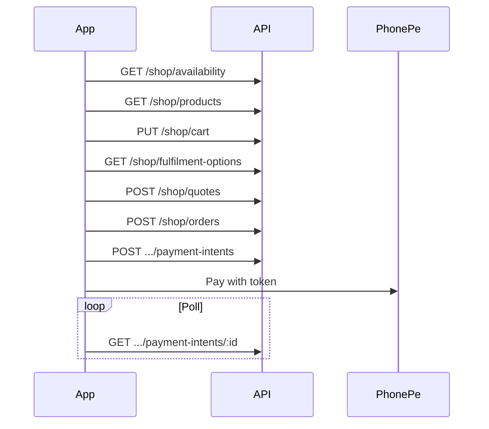
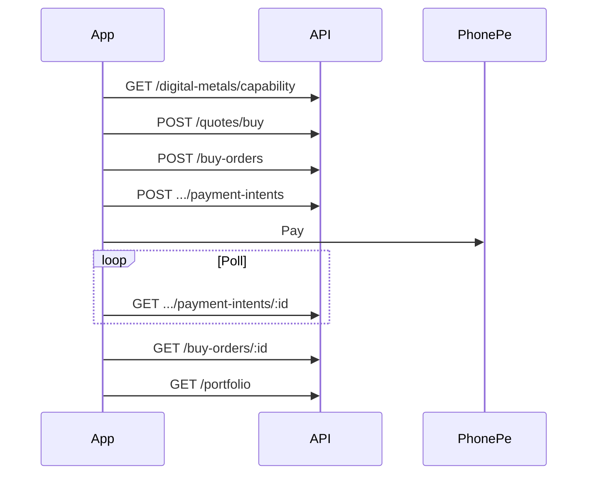

# Flutter customer app — Ecommerce & Digital Gold (integration + payloads)

**Audience:** Flutter/mobile engineers  
**Base URL:** `{API_BASE}/api/v1` (production: `https://swarnagrow-backend.vercel.app/api/v1`)  
**Verified backend commit:** `b1a03cd` (`ecommerce`, Oct 2026)

Every section below includes **example requests and responses** as returned by the API (`{ success, data, meta?, error? }`). Money is **paise** (integer). Digital metal quantity is **micrograms** as strings (`"1000000"` = 1 g at 999 fineness).

---

## 0. Conventions

### Authenticated calls

```http
GET /api/v1/app/...
Authorization: Bearer eyJ...
X-Platform: android
X-App-Version: 1.2.0
```

### Mutations (required)

```http
X-Idempotency-Key: 550e8400-e29b-41d4-a716-446655440001
```

Reuse the **same** key when retrying the same user action after a timeout.

### Success envelope

```json
{
  "success": true,
  "data": { }
}
```

List endpoints may add:

```json
"meta": { "limit": 20, "nextCursor": "eprd_01NEXT", "hasMore": true }
```

### Error envelope

```json
{
  "success": false,
  "error": {
    "code": "QUOTE_EXPIRED",
    "message": "Quote has expired. Request a new quote.",
    "traceId": "tr_abc123",
    "details": {}
  }
}
```

Branch UI on `error.code`. Log `traceId` for support.

---

## 1. Authentication (before shop / Digital Gold)

### 1.1 Request OTP

```http
POST /api/v1/public/auth/otp/request
Content-Type: application/json
X-Idempotency-Key: otp-req-001
```

```json
{
  "tenantCode": "KAIRALI",
  "mobile": "+919876543210",
  "purpose": "LOGIN",
  "deviceId": "flutter-device-uuid"
}
```

**Response `200`**

```json
{
  "success": true,
  "data": {
    "otpId": "550e8400-e29b-41d4-a716-446655440000",
    "channel": "SMS",
    "maskedMobile": "******3210",
    "resendAvailableInSeconds": 30,
    "attemptsAllowed": 5,
    "expiresInSeconds": 300,
    "isRegistered": true
  }
}
```

### 1.2 Verify OTP → access token

```http
POST /api/v1/public/auth/otp/verify
X-Idempotency-Key: otp-verify-001
```

```json
{
  "tenantCode": "KAIRALI",
  "mobile": "+919876543210",
  "purpose": "LOGIN",
  "deviceId": "flutter-device-uuid",
  "otpId": "550e8400-e29b-41d4-a716-446655440000",
  "otp": "123456",
  "deviceInfo": {
    "deviceId": "flutter-device-uuid",
    "platform": "android",
    "appVersion": "1.0.0",
    "osVersion": "15",
    "deviceModel": "Pixel 9"
  }
}
```

**Response `200`**

```json
{
  "success": true,
  "data": {
    "isNewCustomer": false,
    "profileComplete": true,
    "customer": {
      "id": "customer_01",
      "name": "Anu Joseph",
      "mobile": "+919876543210",
      "branchId": "branch_01",
      "passbookNumber": "PB-00124",
      "branch": { "id": "branch_01", "name": "Main Branch", "code": "HO" },
      "profileComplete": true
    },
    "tenantCapabilities": {
      "customerSelfEnrol": true,
      "customerSelfRegistration": true,
      "kycMandatory": false,
      "multiScheme": true,
      "customerLoginMode": "OTP_ONLY",
      "customerAppWriteEnabled": true,
      "customerAppPaymentsEnabled": true
    },
    "accessToken": "eyJ...",
    "refreshToken": "...",
    "expiresIn": 2592000,
    "tokenType": "Bearer"
  }
}
```

Use `accessToken` on all `/app/*` routes below. Refresh: `POST /app/auth/refresh` with `{ "refreshToken": "..." }`.

---

## 2. Ecommerce shop (`/app/shop/*`)

### 2.1 Store availability (gate UI)

```http
GET /api/v1/app/shop/availability
Authorization: Bearer eyJ...
```

**Response `200`**

```json
{
  "success": true,
  "data": {
    "available": true,
    "ecommerce": {
      "planEntitled": true,
      "enabled": true,
      "active": true,
      "hasOrderHistory": false
    },
    "hasOrderHistory": false,
    "orderHistoryAvailable": false
  }
}
```

If `available: false`, hide checkout; you may still show **My orders** when `hasOrderHistory: true`. Other shop routes may return `403` with `ECOMMERCE_NOT_AVAILABLE`.

### 2.2 Product list

```http
GET /api/v1/app/shop/products?limit=20&categoryId=ecat_01&sort=newest
Authorization: Bearer eyJ...
```

**Response `200`** (array in `data`, pagination in `meta`)

```json
{
  "success": true,
  "data": [
    {
      "id": "eprd_01RING",
      "name": "Classic 22K Ring",
      "slug": "classic-22k-ring",
      "sku": "RNG-22-001",
      "description": "Handcrafted ring",
      "categoryId": "ecat_01",
      "imageUploadIds": ["upload_p1"],
      "imageUrls": [{ "uploadId": "upload_p1", "viewUrl": "/uploads/upload_p1" }],
      "featured": true,
      "status": "PUBLISHED",
      "purity": "22K",
      "goldWeightMg": 4200,
      "priceMode": "GOLD_RATE_BASED",
      "version": 3,
      "pricing": {
        "computable": true,
        "preTaxSubtotalPaise": 3104120,
        "displayTotalPaise": 3195344,
        "preTaxSubtotal": {
          "amountPaise": 3104120,
          "amountRupees": 31041.2,
          "amountDisplay": "₹31,041.20"
        },
        "displayTotal": {
          "amountPaise": 3195344,
          "amountRupees": 31953.44,
          "amountDisplay": "₹31,953.44"
        }
      },
      "availability": {
        "stockPolicy": "MADE_TO_ORDER",
        "availableQuantity": null,
        "purchasable": true,
        "label": "Made to order"
      }
    }
  ],
  "meta": { "limit": 20, "nextCursor": "eprd_01NEXT", "hasMore": true }
}
```

**Detail:** `GET /app/shop/products/{productIdOrSlug}` — same product object in `data`.

Display **`pricing.displayTotal`** only; do not recompute gold-rate products in Flutter.

### 2.3 Cart

```http
GET /api/v1/app/shop/cart
Authorization: Bearer eyJ...
```

**Response `200`**

```json
{
  "success": true,
  "data": {
    "id": "ecart_01",
    "checkoutUsable": false,
    "lines": [
      {
        "productId": "eprd_01RING",
        "quantity": 1,
        "product": {
          "id": "eprd_01RING",
          "name": "Classic 22K Ring",
          "slug": "classic-22k-ring",
          "status": "PUBLISHED"
        },
        "availability": {
          "stockPolicy": "MADE_TO_ORDER",
          "purchasable": true,
          "label": "Made to order"
        }
      }
    ],
    "version": 2
  }
}
```

**Update cart**

```http
PUT /api/v1/app/shop/cart
Authorization: Bearer eyJ...
X-Idempotency-Key: cart-update-001
Content-Type: application/json
```

```json
{
  "expectedVersion": 2,
  "lines": [{ "productId": "eprd_01RING", "quantity": 1 }]
}
```

**Response `200`:** same shape as GET. **`409 VERSION_CONFLICT`** if `expectedVersion` is stale.

### 2.4 Delivery address (optional)

```http
POST /api/v1/app/shop/addresses
X-Idempotency-Key: addr-001
```

```json
{
  "label": "Home",
  "recipientName": "Anu Joseph",
  "mobile": "+919876543210",
  "line1": "Rose Villa",
  "line2": "Near temple",
  "city": "Kochi",
  "state": "Kerala",
  "pincode": "682001",
  "isDefault": true
}
```

**Response `201`:** address object with `id`, `version`, etc.

### 2.5 Fulfilment options

```http
GET /api/v1/app/shop/fulfilment-options
Authorization: Bearer eyJ...
```

**Response `200`**

```json
{
  "success": true,
  "data": {
    "pickup": {
      "enabled": true,
      "branches": [{ "id": "branch_01", "name": "Main Branch", "code": "HO" }]
    },
    "delivery": {
      "enabled": true,
      "serviceablePincodes": ["682001", "682016"],
      "deliveryChargePaise": 15000,
      "supportedDestinationStates": ["Kerala"],
      "codEnabled": true,
      "codPincodes": ["682001"]
    },
    "checkoutUsable": true,
    "checkoutReadiness": { "ready": true, "blockers": [] }
  }
}
```

### 2.6 Checkout quote

**Pickup + online**

```http
POST /api/v1/app/shop/quotes
X-Idempotency-Key: quote-001
```

```json
{
  "fulfilmentMode": "BRANCH_PICKUP",
  "pickupBranchId": "branch_01",
  "paymentMethod": "ONLINE"
}
```

**Delivery + COD**

```json
{
  "fulfilmentMode": "DELIVERY",
  "addressId": "eaddr_01",
  "paymentMethod": "COD"
}
```

**Response `201`**

```json
{
  "success": true,
  "data": {
    "id": "equote_01",
    "status": "ACTIVE",
    "lines": [
      {
        "productId": "eprd_01RING",
        "productVersion": 3,
        "name": "Classic 22K Ring",
        "sku": "RNG-22-001",
        "quantity": 1,
        "unitPricePaise": 3104120,
        "lineTotalPaise": 3104120
      }
    ],
    "fulfilmentMode": "BRANCH_PICKUP",
    "pickupBranchId": "branch_01",
    "subtotalPaise": 3104120,
    "taxPaise": 91224,
    "fulfilmentChargePaise": 0,
    "totalPaise": 3195344,
    "expiresAt": "2026-03-15T10:20:00.000Z",
    "paymentMethod": "ONLINE",
    "paymentAllowed": true,
    "orderPlacementAllowed": true,
    "checkoutUsable": true,
    "previewOnly": false,
    "blockers": []
  }
}
```

If `previewOnly: true`, payments are disabled (staging) — show totals only. After `expiresAt`, create a new quote.

### 2.7 Place order

```http
POST /api/v1/app/shop/orders
X-Idempotency-Key: order-001
```

```json
{
  "quoteId": "equote_01"
}
```

**Response `201` — online (awaiting payment)**

```json
{
  "success": true,
  "data": {
    "id": "eord_01",
    "orderNumber": "SG-2026-00042",
    "status": "PENDING_PAYMENT",
    "statusLabel": "Awaiting payment — not charged",
    "paymentMethod": "ONLINE",
    "paymentAllowed": true,
    "paymentCompleted": false,
    "quoteId": "equote_01",
    "fulfilmentMode": "BRANCH_PICKUP",
    "pickupBranchId": "branch_01",
    "subtotalPaise": 3104120,
    "taxPaise": 91224,
    "totalPaise": 3195344,
    "expiresAt": "2026-03-15T10:35:00.000Z",
    "version": 1,
    "invoiceAvailable": false
  }
}
```

**COD:** `status: "COD_PENDING_ACCEPTANCE"`, `paymentAllowed: false` — jeweller accepts in admin before fulfilment.

### 2.8 PhonePe payment (shop)

```http
POST /api/v1/app/shop/orders/eord_01/payment-intents
X-Idempotency-Key: pay-intent-001
```

```json
{
  "redirectUrl": "myapp://shop/payment-return"
}
```

**Response `201`**

```json
{
  "success": true,
  "data": {
    "id": "epay_01",
    "orderId": "eord_01",
    "status": "INITIATED",
    "amountPaise": 3195344,
    "currency": "INR",
    "merchantOrderId": "epay_01",
    "token": "phonepe-sdk-or-intent-token",
    "redirectUrl": "myapp://shop/payment-return",
    "orderStatus": "PENDING_PAYMENT",
    "paymentCompleted": false,
    "statusPollUrl": "/app/shop/orders/eord_01/payment-intents/epay_01"
  }
}
```

Open PhonePe with `token`. Poll:

```http
GET /api/v1/app/shop/orders/eord_01/payment-intents/epay_01
Authorization: Bearer eyJ...
```

**Response `200` (success)**

```json
{
  "success": true,
  "data": {
    "paymentIntent": {
      "id": "epay_01",
      "status": "COMPLETED",
      "amountPaise": 3195344,
      "orderStatus": "PAID",
      "paymentCompleted": true,
      "failureReason": null
    }
  }
}
```

Also handle FCM: `ECOMMERCE_ORDER_CONFIRMED`, `ECOMMERCE_PAYMENT_FAILED`, `ECOMMERCE_PAYMENT_EXPIRED`.

### 2.9 Orders list & detail

```http
GET /api/v1/app/shop/orders?limit=20
Authorization: Bearer eyJ...
```

**Response `200`**

```json
{
  "success": true,
  "data": [
    {
      "id": "eord_01",
      "orderNumber": "SG-2026-00042",
      "status": "PAID",
      "statusLabel": "PAID",
      "paymentMethod": "ONLINE",
      "totalPaise": 3195344,
      "createdAt": "2026-03-15T10:06:00.000Z",
      "fulfilmentMode": "BRANCH_PICKUP"
    }
  ],
  "meta": { "limit": 20, "nextCursor": null, "hasMore": false }
}
```

`GET /app/shop/orders/{orderId}` — full order including `deliveryTracking`, `refundStatus`, `invoiceAvailable`. Invoice: `GET /app/shop/orders/{orderId}/invoice.pdf` when available.

### 2.10 Ecommerce flow (sequence)



---

## 3. Digital Gold & Silver (`/app/digital-metals/*`)

### 3.1 Capability (gate UI)

```http
GET /api/v1/app/digital-metals/capability
Authorization: Bearer eyJ...
```

**Response `200`**

```json
{
  "success": true,
  "data": {
    "enabled": true,
    "planEntitled": true,
    "tenantEnabled": true,
    "paused": false,
    "hasLegacyActivity": false,
    "canViewHoldings": true,
    "canViewHistory": true,
    "canPlaceNewBuy": true,
    "canPlaceNewSell": true,
    "canPlaceRedemption": true,
    "blockers": [],
    "termsVersion": "2026-10-01",
    "termsContentHash": "sha256:abc...",
    "taxProfileApproved": true,
    "assets": [
      {
        "metal": "GOLD",
        "finenessPpm": 999000,
        "quoteReady": true,
        "rateTiming": "CURRENT",
        "issues": []
      }
    ],
    "pause": {
      "tenantPaused": false,
      "platformPaused": false
    }
  }
}
```

Use `canPlaceNewBuy` / `canPlaceNewSell` / `canPlaceRedemption` for CTAs. Pass `termsVersion` + `termsContentHash` when creating orders from quotes.

### 3.2 Portfolio & passbook

```http
GET /api/v1/app/digital-metals/portfolio
Authorization: Bearer eyJ...
```

**Response `200`**

```json
{
  "success": true,
  "data": {
    "items": [
      {
        "metal": "GOLD",
        "finenessPpm": 999000,
        "heldUg": "5000000",
        "reservedUg": "2000000",
        "availableUg": "3000000",
        "pendingBuyUg": "0"
      }
    ]
  }
}
```

```http
GET /api/v1/app/digital-metals/passbook?limit=20
```

**Response `200`:** `{ "success": true, "data": { "items": [ ...ledger entries... ], "meta": { ... } } }` — use for transaction history UI.

### 3.3 Buy flow

#### Step A — Buy quote

```http
POST /api/v1/app/digital-metals/quotes/buy
X-Idempotency-Key: dm-buy-quote-001
```

**Budget in INR**

```json
{
  "metal": "GOLD",
  "finenessPpm": 999000,
  "inputMode": "BUDGET_INR",
  "budgetPaise": 600000,
  "termsVersionAccepted": "2026-10-01"
}
```

**Response `201`**

```json
{
  "success": true,
  "data": {
    "quoteId": "dmq_01ABC",
    "expiresAt": "2026-10-15T12:15:00.000Z",
    "metal": "GOLD",
    "finenessPpm": 999000,
    "metalQuantityUg": "983606",
    "metalSubtotalPaise": 600000,
    "feeLines": [{ "code": "BUY_FEE", "amountPaise": 6000 }],
    "taxLines": [],
    "totalPayablePaise": 606000,
    "budgetRemainderPaise": 0,
    "rateSnapshot": {
      "buyRatePerGramPaise": 610000,
      "rateVersionId": "dmr_01"
    },
    "termsVersion": "2026-10-01",
    "termsContentHash": "sha256:abc...",
    "calculationVersion": "2026-10-15.v1"
  }
}
```

#### Step B — Create buy order

```http
POST /api/v1/app/digital-metals/buy-orders
X-Idempotency-Key: dm-buy-order-001
```

```json
{
  "quoteId": "dmq_01ABC",
  "termsVersionAccepted": "2026-10-01",
  "termsContentHashAccepted": "sha256:abc..."
}
```

**Response `201`**

```json
{
  "success": true,
  "data": {
    "id": "dmbo_01",
    "status": "PAYMENT_PENDING",
    "metal": "GOLD",
    "finenessPpm": 999000,
    "quantityUg": "983606",
    "totalPayablePaise": 606000,
    "quoteExpiresAt": "2026-10-15T12:15:00.000Z",
    "paymentAcceptanceExpiresAt": "2026-10-15T12:45:00.000Z",
    "invoiceStatus": "PENDING",
    "paymentAttempts": [],
    "purchaseSummary": {
      "totalPayablePaise": 606000,
      "metalQuantityUg": "983606"
    }
  }
}
```

#### Step C — Payment intent (PhonePe)

```http
POST /api/v1/app/digital-metals/buy-orders/dmbo_01/payment-intents
X-Idempotency-Key: dm-buy-pay-001
```

```json
{
  "redirectUrl": "myapp://digital-gold/payment-return"
}
```

**Response `201`**

```json
{
  "success": true,
  "data": {
    "id": "dmbpay_01",
    "orderId": "dmbo_01",
    "status": "INITIATED",
    "amountPaise": 606000,
    "currency": "INR",
    "merchantOrderId": "DM-BUY-dmbpay_01",
    "token": "phonepe-token",
    "redirectUrl": "myapp://digital-gold/payment-return",
    "statusPollUrl": "/app/digital-metals/buy-orders/dmbo_01/payment-intents/dmbpay_01",
    "checkoutLabel": null
  }
}
```

Merchant prefix **`DM-BUY-`** distinguishes Digital Metal buys from shop/scheme payments. Non-prod may set `checkoutLabel` when using demo/mock checkout.

#### Step D — Poll payment

```http
GET /api/v1/app/digital-metals/buy-orders/dmbo_01/payment-intents/dmbpay_01
```

Poll until attempt terminal; then poll order:

```http
GET /api/v1/app/digital-metals/buy-orders/dmbo_01
```

**Response `200` (credited)**

```json
{
  "success": true,
  "data": {
    "id": "dmbo_01",
    "status": "CREDITED",
    "metal": "GOLD",
    "finenessPpm": 999000,
    "quantityUg": "983606",
    "totalPayablePaise": 606000,
    "creditedAt": "2026-10-15T12:10:00.000Z",
    "invoiceStatus": "READY",
    "paymentAttempts": [
      {
        "id": "dmbpay_01",
        "status": "SUCCEEDED",
        "amountPaise": 606000,
        "paidAt": "2026-10-15T12:09:30.000Z"
      }
    ]
  }
}
```

Invoice PDF: `GET /app/digital-metals/buy-orders/dmbo_01/invoice` when `invoiceStatus` is `READY`.

**Buy statuses:** `QUOTE_ACCEPTED` → `PAYMENT_PENDING` → `PAYMENT_VERIFIED` → `CREDITED` (or `EXPIRED`, `REFUND_REVIEW`, `REFUNDED`).

### 3.4 Sell flow

#### Step A — Sell quote

```http
POST /api/v1/app/digital-metals/quotes/sell
X-Idempotency-Key: dm-sell-quote-001
```

```json
{
  "metal": "GOLD",
  "finenessPpm": 999000,
  "quantityUg": "1000000"
}
```

(`quantityUg` string — `"1000000"` ≈ 1 gram at 999 ppm fineness scale used in tests.)

**Response `201`**

```json
{
  "success": true,
  "data": {
    "quoteId": "dmq_02SELL",
    "expiresAt": "2026-10-15T12:20:00.000Z",
    "side": "SELL",
    "metal": "GOLD",
    "finenessPpm": 999000,
    "metalQuantityUg": "1000000",
    "settlementPaise": 590000,
    "feeLines": [{ "code": "SELL_FEE", "amountPaise": 5000 }],
    "rateSnapshot": {
      "sellRatePerGramPaise": 600000,
      "rateVersionId": "dmr_01"
    },
    "termsVersion": "2026-10-01",
    "termsContentHash": "sha256:abc..."
  }
}
```

#### Step B — Reserve sell order

```http
POST /api/v1/app/digital-metals/sell-orders
X-Idempotency-Key: dm-sell-order-001
```

```json
{
  "quoteId": "dmq_02SELL",
  "termsVersionAccepted": "2026-10-01",
  "termsContentHashAccepted": "sha256:abc..."
}
```

**Response `201`**

```json
{
  "success": true,
  "data": {
    "id": "dmso_01",
    "status": "RESERVED",
    "metal": "GOLD",
    "finenessPpm": 999000,
    "quantityUg": "1000000",
    "settlementPaise": 590000,
    "quoteExpiresAt": "2026-10-15T12:20:00.000Z",
    "approvalExpiresAt": null,
    "bankDestinationId": null,
    "version": 1
  }
}
```

#### Step C — Bank destination (if none ACTIVE)

```http
POST /api/v1/app/digital-metals/bank-destinations
X-Idempotency-Key: dm-bank-001
```

```json
{
  "accountHolderName": "Anu Joseph",
  "accountNumber": "123456789012",
  "ifsc": "HDFC0001234",
  "bankName": "HDFC Bank"
}
```

**Response `201`:** destination with `status: "PENDING"` until staff verifies in admin. **Confirm** requires `status: "ACTIVE"`.

```http
GET /api/v1/app/digital-metals/bank-destinations
```

**Response `200`**

```json
{
  "success": true,
  "data": {
    "items": [
      {
        "id": "dmbd_01",
        "accountHolderName": "Anu Joseph",
        "accountLast4": "9012",
        "ifsc": "HDFC0001234",
        "bankName": "HDFC Bank",
        "status": "ACTIVE",
        "verifiedAt": "2026-10-10T08:00:00.000Z"
      }
    ]
  }
}
```

#### Step D — Confirm sell (locks rate, staff approval window)

```http
POST /api/v1/app/digital-metals/sell-orders/dmso_01/confirm
X-Idempotency-Key: dm-sell-confirm-001
```

```json
{
  "bankDestinationId": "dmbd_01"
}
```

**Response `200`**

```json
{
  "success": true,
  "data": {
    "id": "dmso_01",
    "status": "PENDING_APPROVAL",
    "approvalExpiresAt": "2026-10-15T14:20:00.000Z",
    "confirmedAt": "2026-10-15T12:21:00.000Z",
    "bankDestinationId": "dmbd_01"
  }
}
```

Customer app **polls**; staff approves payout in admin. Track bank payout:

```http
GET /api/v1/app/digital-metals/sell-orders/dmso_01/payout-status
```

**Response `200` (after staff execution)**

```json
{
  "success": true,
  "data": {
    "orderId": "dmso_01",
    "saleExecuted": true,
    "bankPayoutSettled": false,
    "payoutDestinationMasked": {
      "accountLast4": "9012",
      "ifsc": "HDFC0001234",
      "accountHolderName": "Anu Joseph"
    },
    "payable": { "status": "OPEN", "outstandingPaise": 590000 },
    "payouts": []
  }
}
```

Cancel before execution: `POST /app/digital-metals/sell-orders/dmso_01/cancel` with idempotency key.

### 3.5 Redemption flow

#### Step A — Catalogue

```http
GET /api/v1/app/digital-metals/redemption/catalogue
Authorization: Bearer eyJ...
```

**Response `200`**

```json
{
  "success": true,
  "data": {
    "items": [
      {
        "id": "dmrci_01",
        "sku": "GOLD-2G-COIN",
        "label": "2g Gold Coin",
        "metal": "GOLD",
        "finenessPpm": 999000,
        "unitQuantityUg": "2000000",
        "mintingRule": { "type": "FLAT_INR", "amountPaise": 50000 },
        "packagingPaise": 0,
        "deliveryFlatPaise": 0,
        "pickupEnabled": true,
        "deliveryEnabled": false,
        "leadTimeDays": 7,
        "active": true
      }
    ]
  }
}
```

#### Step B — Redemption quote

```http
POST /api/v1/app/digital-metals/quotes/redemption
X-Idempotency-Key: dm-red-quote-001
```

```json
{
  "catalogueItemId": "dmrci_01",
  "metal": "GOLD",
  "finenessPpm": 999000,
  "unitCount": 1,
  "fulfilmentMode": "PICKUP",
  "pickupBranchId": "branch_01"
}
```

For delivery: `"fulfilmentMode": "DELIVERY", "deliveryAddressId": "eaddr_01"` (shop address id or DM-specific address per validator).

**Response `201`**

```json
{
  "success": true,
  "data": {
    "quoteId": "dmq_03RED",
    "expiresAt": "2026-10-15T12:30:00.000Z",
    "catalogueItemId": "dmrci_01",
    "metal": "GOLD",
    "finenessPpm": 999000,
    "quantityUg": "2000000",
    "unitCount": 1,
    "chargeTotalPaise": 50000,
    "fulfilmentMode": "PICKUP",
    "pickupBranchId": "branch_01",
    "pickupBranchLabel": "Main Branch",
    "termsVersion": "2026-10-01",
    "termsContentHash": "sha256:abc..."
  }
}
```

#### Step C — Create redemption order

```http
POST /api/v1/app/digital-metals/redemption/orders
X-Idempotency-Key: dm-red-order-001
```

```json
{
  "quoteId": "dmq_03RED",
  "termsVersionAccepted": "2026-10-01",
  "termsContentHashAccepted": "sha256:abc..."
}
```

**Response `201`**

```json
{
  "success": true,
  "data": {
    "id": "dmro_01",
    "status": "CHARGE_DUE",
    "metal": "GOLD",
    "finenessPpm": 999000,
    "quantityUg": "2000000",
    "unitCount": 1,
    "chargeTotalPaise": 50000,
    "fulfilmentMode": "PICKUP",
    "pickupBranchId": "branch_01",
    "quoteExpiresAt": "2026-10-15T12:30:00.000Z",
    "chargePaymentExpiresAt": "2026-10-15T13:00:00.000Z",
    "version": 1
  }
}
```

If `chargeTotalPaise > 0`, pay making/delivery charges:

```http
POST /api/v1/app/digital-metals/redemption/orders/dmro_01/payment-intents
X-Idempotency-Key: dm-red-pay-001
```

```json
{
  "redirectUrl": "myapp://digital-gold/redemption-payment"
}
```

Poll: `GET .../payment-intents/{attemptId}` (same pattern as buy). Merchant prefix **`dmrpay_`**.

#### Step D — Fulfilment tracking

```http
GET /api/v1/app/digital-metals/redemption/orders/dmro_01/fulfilment
```

**Response `200`:** `status`, `permittedActions`, `leadTimeDays`, `carrier`, `trackingReference`, `shipmentHistory`, `hasPickupCode`.

Pickup code (customer-only):

```http
GET /api/v1/app/digital-metals/redemption/orders/dmro_01/pickup-instructions
```

### 3.6 Open orders hub

```http
GET /api/v1/app/digital-metals/orders/open-summary
Authorization: Bearer eyJ...
```

**Response `200`**

```json
{
  "success": true,
  "data": {
    "openBuyCount": 1,
    "openSellCount": 0,
    "openRedemptionCount": 0,
    "totalOpen": 1
  }
}
```

List endpoints: `GET /app/digital-metals/buy-orders`, `sell-orders`, `redemption/orders` with `limit`, `cursor`, optional `status`.

### 3.7 Digital Gold flow (sequence)



---

## 4. Shared payment rules (shop + DM)

1. New `X-Idempotency-Key` per **Pay now** tap on payment-intent.
2. Always pass `redirectUrl` (deep link) for return from UPI app.
3. Poll every 2–3s with backoff until terminal status; on app resume, poll once before showing failure.
4. Trust **`paymentCompleted`** / order `status` from API — not the PhonePe client callback alone.

---

## 5. Flutter configuration

```dart
const apiBase = String.fromEnvironment(
  'API_BASE',
  defaultValue: 'https://swarnagrow-backend.vercel.app/api/v1',
);
```

| Environment | Base |
|-------------|------|
| Local | `http://localhost:4050/api/v1` |
| Production | `https://swarnagrow-backend.vercel.app/api/v1` |

Deep links (examples): `/shop`, `/shop/products/{slug}`, `/shop/order/{orderId}`, Digital Gold routes in [FCM_CUSTOMER_APP_INTEGRATION.md](./FCM_CUSTOMER_APP_INTEGRATION.md).

---

## 6. Deployment reference

- **API:** Vercel project `swarnagrow-backend` → `https://swarnagrow-backend.vercel.app`
- **Health:** `GET https://swarnagrow-backend.vercel.app/health`
- **Workers** (FCM, payment reconcile): not on Vercel — see [DEPLOY_VERCEL_AND_WORKERS.md](./DEPLOY_VERCEL_AND_WORKERS.md)

---

## 7. Further detail

| Topic | Doc |
|-------|-----|
| Every shop route + cancel/return | [ECOMMERCE_CUSTOMER_APP_GUIDE.md](./ECOMMERCE_CUSTOMER_APP_GUIDE.md) |
| Schemes, FCM, devices | [FLUTTER_CUSTOMER_API_GUIDE.md](./FLUTTER_CUSTOMER_API_GUIDE.md) |
| DM admin + error codes | [DIGITAL_METALS_API_CONTRACT.md](./DIGITAL_METALS_API_CONTRACT.md) |
| Business rules / TTLs | [DIGITAL_METALS_SPEC.md](./DIGITAL_METALS_SPEC.md) |

---

## 8. Idempotency cheat sheet

| User action | Endpoint |
|-------------|----------|
| Cart update | `PUT /app/shop/cart` |
| Shop quote / order / pay | `POST /app/shop/quotes`, `orders`, `.../payment-intents` |
| DM buy quote / order / pay | `POST .../quotes/buy`, `buy-orders`, `.../payment-intents` |
| DM sell quote / order / confirm | `POST .../quotes/sell`, `sell-orders`, `.../confirm` |
| DM redemption quote / order / pay | `POST .../quotes/redemption`, `redemption/orders`, `.../payment-intents` |
| Bank account add | `POST /app/digital-metals/bank-destinations` |
| Shop address add | `POST /app/shop/addresses` |
