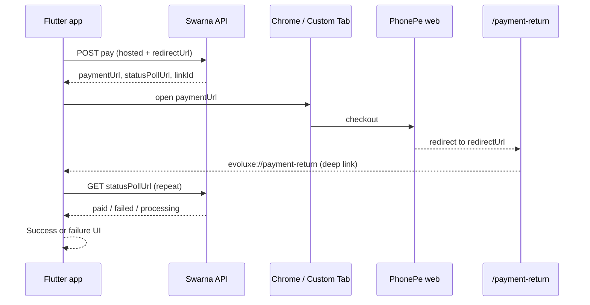

# Flutter — hosted PhonePe (web) checkout, return to app, poll for success

**Scope:** Customer app **without PhonePe native SDK**. User pays on PhonePe **in the browser**; your app gets them back via **`redirectUrl`**, then **polls the API** for the real outcome.

| | Production | Local dev |
|--|--|--|
| API base | `https://swarnagrow-backend.vercel.app/api/v1` | `http://localhost:4050/api/v1` |
| **`redirectUrl`** (always send on pay POST) | `https://swarnagrow-tenant-admin.vercel.app/payment-return` | `http://localhost:5173/payment-return` |
| Bridge page | Opens `evoluxe://payment-return` (deep link) | Same scheme |

**Copy this doc to Flutter.** Backend repo is source of truth; Tenant Admin has a short pointer in `docs/FLUTTER_HOSTED_PAYMENT_RETURN.md`.

---

## Whole flow (read once)



| Step | Who | What |
|------|-----|------|
| 1 | App | `POST` pay with **`X-Checkout-Channel: hosted`** + **`redirectUrl`** |
| 2 | App | Store `paymentUrl`, **`statusPollUrl`**, `linkId` / `intentId` |
| 3 | App | Open **`paymentUrl`** in **Custom Tab** or external browser |
| 4 | App | Optional: start **background poll** while browser is open |
| 5 | User | Pays on PhonePe (UPI / QR / etc.) |
| 6 | PhonePe | Redirects to **`redirectUrl`** (bridge page) |
| 7 | Bridge | Tries **`evoluxe://payment-return`** → user lands in app |
| 8 | App | On resume / deep link: **poll `statusPollUrl`** every 2–3 s |
| 9 | App | If `paid: true` → success; if `failed: true` → failure; else keep waiting (up to ~5 min) |

**Rules**

- **`redirectUrl`** only brings the user **back to the app**. It does **not** mean payment succeeded.
- **Poll response** is the only source of truth (not PhonePe green tick, not bridge HTML).
- Do **not** use `/customer/.../pay/status` or any tenant-admin “payment status unknown” customer page as `redirectUrl`.

---

## Constants (put in Flutter config)

```dart
// production
const apiBase = 'https://swarnagrow-backend.vercel.app/api/v1';
const paymentRedirectUrl =
    'https://swarnagrow-tenant-admin.vercel.app/payment-return';
const paymentDeepLink = 'evoluxe://payment-return';

// local dev
// const apiBase = 'http://localhost:4050/api/v1';
// const paymentRedirectUrl = 'http://localhost:5173/payment-return';
```

Register **`paymentDeepLink`** in Android `AndroidManifest` and iOS URL types (or universal links to the same https path).

---

## Headers (every authenticated payment POST)

```http
Authorization: Bearer <customer_access_token>
Content-Type: application/json
X-Idempotency-Key: <uuid-v4-new-per-tap>
X-Checkout-Channel: hosted
```

Optional: `X-App-Version: 1.0.0`

**Do not** call `POST .../pay/sdk-order` or send `X-Checkout-Channel: sdk` until SDK is approved.

---

## A. Fixed scheme instalment (e.g. EVOLUXE fixed plan)

### A.1 Payable range

```http
GET /api/v1/app/schemes/{schemeId}/payable-range
Authorization: Bearer <token>
```

Use `maxPayablePaise` (or the amount shown in UI) for the pay body.

### A.2 Start checkout

```http
POST /api/v1/app/schemes/{schemeId}/pay
Authorization: Bearer <token>
X-Idempotency-Key: 7c9e2f1a-4b3d-4e5f-9a0b-1c2d3e4f5a6b
X-Checkout-Channel: hosted
Content-Type: application/json
```

```json
{
  "amountPaise": 500000,
  "redirectUrl": "https://swarnagrow-tenant-admin.vercel.app/payment-return"
}
```

**`201` response shape (hosted) — fields you must use:**

```json
{
  "success": true,
  "data": {
    "id": "plk_01XXXXXXXX",
    "paymentLinkId": "plk_01XXXXXXXX",
    "checkoutKind": "HOSTED_REDIRECT",
    "provider": "PHONEPE",
    "paymentUrl": "https://mercury-uat.phonepe.com/...",
    "gatewayUrl": "https://mercury-uat.phonepe.com/...",
    "statusPollUrl": "/app/payments/plk_01XXXXXXXX/status",
    "amount": { "paise": 500000, "display": "₹5,000" },
    "status": "CREATED",
    "expiresAt": "2026-11-07T10:30:00.000Z"
  }
}
```

| Field | Flutter action |
|--------|----------------|
| `checkoutKind` | Assert `HOSTED_REDIRECT` |
| `paymentUrl` | `launchUrl` / Custom Tabs |
| `statusPollUrl` | Prefix with `apiBase` and poll |
| `id` / `paymentLinkId` | Save for support / logging |

### A.3 Poll (fixed scheme)

```http
GET /api/v1/app/payments/{paymentLinkId}/status
Authorization: Bearer <token>
```

Example poll body:

```json
{
  "success": true,
  "data": {
    "linkId": "plk_01XXXXXXXX",
    "status": "PROCESSING",
    "processing": true,
    "paid": false,
    "failed": false,
    "receipt": null,
    "updatedScheme": null,
    "retryAfterSeconds": 3
  }
}
```

When paid:

```json
{
  "data": {
    "status": "PAID",
    "processing": false,
    "paid": true,
    "failed": false,
    "receipt": {
      "paymentId": "pay_01XXXXXXXX",
      "receiptNumber": "RCT-...",
      "paidAt": "2026-11-07T10:20:00.000Z"
    },
    "updatedScheme": { "id": "sch_01...", "status": "ACTIVE" },
    "retryAfterSeconds": null
  }
}
```

**Poll loop (pseudo-Dart):**

```dart
Future<PaymentOutcome> waitForSchemePayment(String pollPath) async {
  final deadline = DateTime.now().add(const Duration(minutes: 5));
  while (DateTime.now().isBefore(deadline)) {
    final res = await api.get('$apiBase$pollPath');
    final d = res.data;
    if (d['paid'] == true) return PaymentOutcome.success(d['receipt']);
    if (d['failed'] == true) return PaymentOutcome.failed;
    await Future.delayed(Duration(seconds: d['retryAfterSeconds'] ?? 3));
  }
  return PaymentOutcome.timeout;
}
```

Run this:

- While browser is open (optional), **and**
- After app resumes from deep link (**required**).

---

## B. Flexible scheme pay

```http
POST /api/v1/app/schemes/{schemeId}/payment-intents
X-Checkout-Channel: hosted
```

```json
{
  "amountPaise": 75000,
  "targetCycle": "2026-11",
  "expectedPositionVersion": 9,
  "redirectUrl": "https://swarnagrow-tenant-admin.vercel.app/payment-return"
}
```

Poll:

```http
GET /api/v1/app/payment-intents/{intentId}
```

Same flags: `paid`, `failed`, `processing`, `retryAfterSeconds`.

---

## C. Shop & digital gold

Same pattern: **`X-Checkout-Channel: hosted`**, same **`redirectUrl`**, open **`paymentUrl`**, poll **`statusPollUrl`** from the `201` response.

| Flow | POST |
|------|------|
| Shop | `/api/v1/app/shop/orders/{orderId}/payment-intents` |
| Buy gold | `/api/v1/app/digital-metals/buy-orders/{orderId}/payment-intents` |
| Redemption charge | `/api/v1/app/digital-metals/redemption-orders/{orderId}/payment-intents` (if applicable) |

```json
{
  "redirectUrl": "https://swarnagrow-tenant-admin.vercel.app/payment-return",
  "idempotencyKey": "<uuid>"
}
```

(Exact body keys per existing integration guides; **`redirectUrl` is mandatory** for hosted.)

---

## D. Opening PhonePe in Flutter

**Recommended:** `flutter_custom_tabs` or `url_launcher` with external application.

```dart
await launchUrl(
  Uri.parse(paymentUrl),
  mode: LaunchMode.externalApplication, // or custom tabs
);
```

Prefer **Custom Tab / external Chrome**, not an embedded WebView without UPI intent support.

**UPI ID / more apps:** On PhonePe hosted mobile, tap **“Apps & UPI QR”** for QR and collect (VPA) options.

---

## E. Returning to the app after web payment

1. PhonePe loads  
   `https://swarnagrow-tenant-admin.vercel.app/payment-return`  
   (optionally with query params).
2. Bridge page immediately tries  
   `evoluxe://payment-return`  
   (must match app registration).
3. Wire **`uni_links` / `app_links`** so `payment-return` path or scheme opens your app.
4. In the handler: **do not** show final success yet — **continue polling** `statusPollUrl`.

If the app does not open automatically, user can switch back manually; polling should still complete.

---

## F. App lifecycle checklist

- [ ] On pay tap: new `X-Idempotency-Key`.
- [ ] Persist `statusPollUrl` in memory or secure storage until terminal state.
- [ ] Start poll before or when opening browser; **never stop** until `paid` / `failed` / timeout.
- [ ] Listen for `AppLifecycleState.resumed` and deep links → trigger poll.
- [ ] Success UI only when `data.paid == true`.
- [ ] Refresh scheme / order screen from `updatedScheme` or your list APIs.

---

## G. Errors

| Symptom | Cause | Fix |
|---------|--------|-----|
| 422 `redirectUrl origin is not allowed` | Origin not in backend `CORS_ORIGINS` or tenant `branding.websiteUrl` | Use exact Vercel or localhost URLs above |
| Bridge “Returning to app” but app says failed | Stopped polling too early or old backend grace | Use production API; poll up to 5 min |
| `checkoutKind` is `SDK_ORDER` | Wrong headers / wrong endpoint | `X-Checkout-Channel: hosted`, not `sdk-order` |
| PhonePe success but poll pending | Normal delay | Keep polling |

---

## H. What not to do

- Do not set `redirectUrl` to customer portal payment-status routes.
- Do not treat bridge or PhonePe UI as payment confirmation.
- Do not use `pay/sdk-order` in hosted-only builds.
- Do not send `redirectUrl` omitting `https` in production.

---

## I. Quick test (EVOLUXE)

1. Login customer app → bearer token.
2. `POST .../schemes/{schId}/pay` with body above.
3. Open `paymentUrl` in phone browser → sandbox pay.
4. Confirm redirect hits `/payment-return` and app opens.
5. Poll until `paid: true`.
6. Confirm instalment / receipt in app and tenant admin.

---

## J. Support

- Integration: this file + `docs/FLUTTER_CHECKOUT_CHANNEL_INTEGRATION.md`
- PhonePe UPI: `docs/FLUTTER_PHONEPE_INTEGRATION.md`
